# oilpaint

[](https://github.com/joce/oilpaint/actions/workflows/ci.yml)
[](https://codecov.io/gh/joce/oilpaint)
[](https://github.com/astral-sh/ruff)
[](https://github.com/psf/black)
[](https://github.com/joce/oilpaint/blob/main/LICENSE)

A small Python API that mimics oil painting. You describe **strokes** (a spline,
a paint, an amount of paint, a brush width and pressure) and the library
simulates how the paint is laid down, picked up, dragged and mixed on the
canvas. Colors mix like real pigments (blue + yellow gives green, not grey),
using spectral Kubelka-Munk theory.

Install with `pip install oilpaint` (Python 3.11 or newer).

Dependencies: `numpy` and `numba` (the stroke engine and the renderer are
compiled: the first stroke after installing takes about 35 seconds while it
compiles, the first knife stroke about 7 seconds more, and the first lit
render about 10; the result is cached, so this happens once per install and
per machine). Pillow is optional, for `Canvas.to_pil()` and
`Reference`.

## Quick start

```python
from oilpaint import Canvas, Paint

canvas = Canvas(600, 400)

blue = Paint("#23399b", opacity=0.5)
yellow = Paint("#f7c600")

# A stroke: a smooth spline through these points, a paint, an amount of paint.
canvas.stroke([(60, 140), (250, 100), (540, 170)], paint=blue, amount=12, width=50)

# Cross it while it's wet. Pressure decides how much the colors churn together.
canvas.stroke([(200, 30), (230, 200), (190, 370)], paint=yellow, amount=10, width=40, pressure=0.2)
canvas.stroke([(400, 30), (430, 200), (390, 370)], paint=yellow, amount=10, width=40, pressure=0.9)

# No paint = a clean brush that drags and blends what's wet.
canvas.stroke([(80, 300), (560, 300)], width=40, pressure=0.6)

canvas.save("painting.png")
```

Run `python examples/demo.py` to regenerate the demo images in
`examples/output/` (about a minute and a half); see
[Development](#development) for the tests and checks.

## Four paintings made with it

Each is a single script where every mark is a `canvas.stroke(...)`; numpy only
decides where the strokes go.

Each was also made a different way. The Bruegel is painted from memory: a
winter village made up in his manner, with no picture to look at. The Bob Ross
follows his method, step by step as he taught it on television, rather than
any particular painting. The Rembrandt copies one real painting, matching a
photograph of it as closely as the strokes allow. The Kandinsky is made up in
his manner, like the Bruegel, and painted on the back of glass, in reverse.

* `examples/bruegel_winter.py`: a winter village in the manner of Pieter
  Bruegel the Elder, painted thinly on an oak panel with soft sable brushes,
  back to front, letting layers dry (about 21,000 strokes, ~2 minutes).
* `examples/bob_ross_style.py`: a mountain lake painted wet-on-wet in the
  manner of Bob Ross, in the order he worked on the show: Liquid White over
  the whole canvas; the sky in criss-cross strokes with a two-inch brush;
  clouds scrubbed in and blended; the mountain cut in with the knife, its snow
  laid on with almost no pressure so it breaks; a misty tree line tapped in;
  evergreens built with the fan brush from the top down; happy little bushes
  tapped dark and then highlighted; water lines cut with the knife edge
  (about 32,000 strokes, ~3 minutes).
* `examples/rembrandt_self_portrait.py`: a study after Rembrandt's
  *Self-Portrait* of 1659 (National Gallery of Art, Washington; public
  domain), painted from a reproduction (`examples/reference`) the way he
  worked: a warm brown ground; a monochrome "dead colouring" left to dry; the
  background, coat and beret brushed in thin and fluid, then softened with a
  mop; the head worked up wet-into-wet from big brushes to small, each stroke
  following the form (`Reference.trace`) in a colour mixed from his palette
  (`palette.match` with `palette.OLD_MASTER`); the lights piled up in stiff
  lead white; the hair in thin strokes following the swirl of its curls,
  the curls themselves traced from a close-up of the head, scratched into the
  wet paint with the brush handle or drawn on with a liner;
  transparent glazes over the dried shadows (about 18,000 strokes, ~5 minutes;
  `REMBRANDT_SCALE=0.5` for a quick half-size version).
* `examples/kandinsky_glass.py`: a reverse glass painting in the manner of
  Wassily Kandinsky's Murnau years (1909-1911), when he and Gabriele Münter
  took up the Bavarian folk craft of painting behind glass. Onion-domed towers
  on a snowy hill, a rider galloping up it in front of blue mountains, a sun
  and a dark cloud, a road, a river with a rowing boat, and patches of colour
  floating free of the lines. It is painted on the back of the glass and seen
  through it, so it goes on in reverse, each layer left to dry: the black
  lines first, then the windows and glints, the floating patches, the colours
  of things (uneven dabs, then a solid coat behind them), and the sky last of
  all, over everything. Black card behind the glass, as Kandinsky used
  (about 4,800 strokes, ~1.5 minutes).

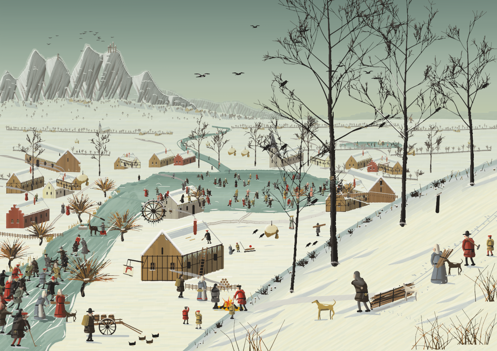

*A winter village in the manner of Pieter Bruegel the Elder, painted from
memory with no picture to look at: thin paint on an oak panel, soft sable
brushes, back to front, each layer left to dry. About 21,000 strokes.*

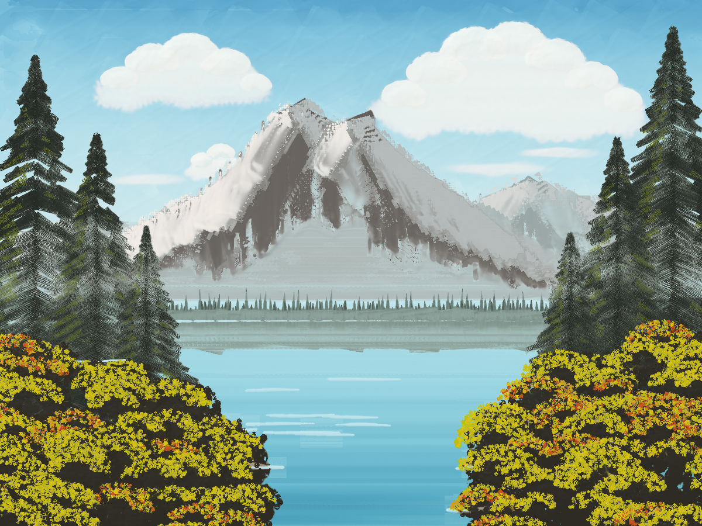

*A mountain lake in the manner of Bob Ross, following his method step by step
rather than any one painting: wet-on-wet over Liquid White, criss-cross sky,
the mountain cut in with the knife, a misty tree line, fan-brush evergreens,
happy little bushes, and water lines cut with the knife edge.*

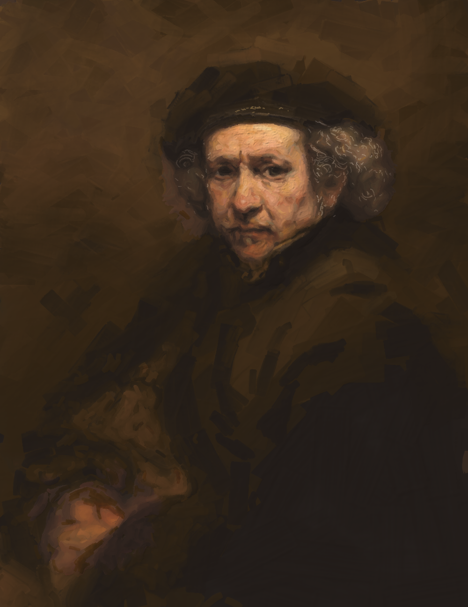

*A study after Rembrandt's* Self-Portrait *of 1659, copying the real painting
from a photograph of it: a monochrome underpainting left to dry, the head
worked up wet-into-wet from big brushes to small with each stroke following
the form, the lights piled up in lead white, the curls scratched into the wet
paint, and glazes over the dried shadows. About 18,000 strokes.*

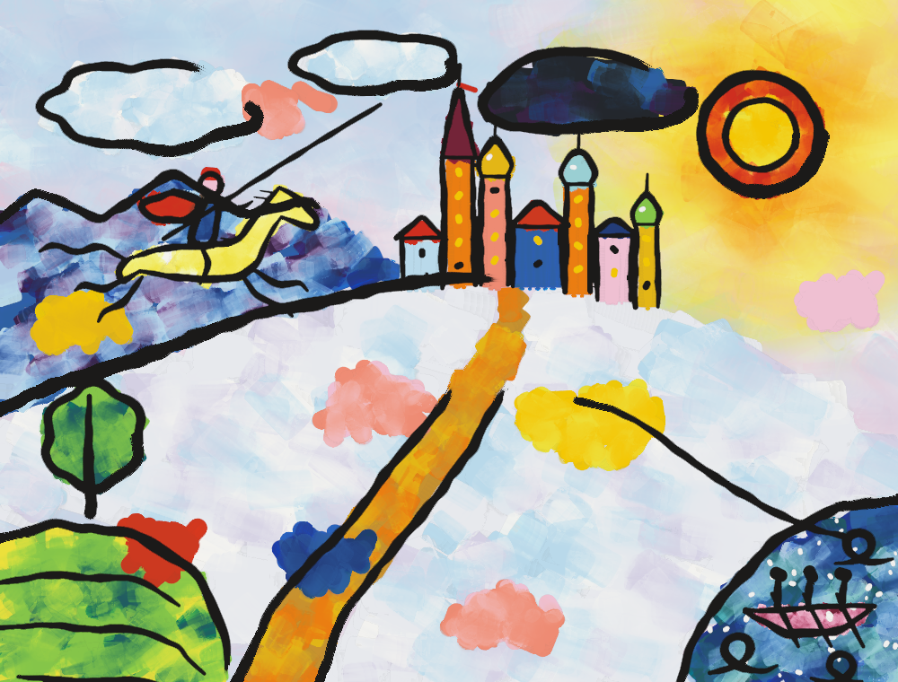

*A reverse glass painting in the manner of Kandinsky's Murnau years, made up
rather than copied: painted on the back of the glass, black lines first and
the sky last, and seen through the front. No brush relief shows through the
glass, only colour.*

### Two masters, two tools

Each of these studies is painted from a photograph of a real painting
(`examples/reference`, all public domain), and painted mostly with one of the
tools from **Dabbing and spatter**, the way its painter is known to
have used it. They are painted up coarse to fine, the way the Rembrandt study
is: every pass looks at the canvas so far, compares it with the photograph as
a tool of that size sees it, and paints only where the two still differ, in
the colour that brings the canvas closer (`examples/_studies.py`).

* `examples/seurat_grande_jatte.py`: Georges Seurat's *Gray Weather, Grande
  Jatte* (about 1886-88, The Metropolitan Museum of Art), in pointillist dots
  tapped on with `canvas.stipple` over a thin lay-in of about 4,000 strokes:
  about 134,000 dots, bigger ones first, each the colour the photograph shows
  where it falls, made purer and set further apart from its neighbours'
  colours, with now and then a dot of its complement. Each layer of dots is tapped on in sittings
  left to dry, so the dots keep their own colour (~3 minutes).
* `examples/whistler_rocket.py`: James McNeill Whistler's *Nocturne in Black
  and Gold: The Falling Rocket* (1875, Detroit Institute of Arts), the
  painting John Ruskin said flung "a pot of paint in the public's face": thin
  washes of fluid paint swept over a dark ground with a mop, the smoke soft;
  and the sparks flicked on with `canvas.spatter`, a flick for each shower of
  sparks in the photograph, falling from just above it (about 3,200 brush
  strokes, then 160 flicks and 1,700 drops; ~1 minute).

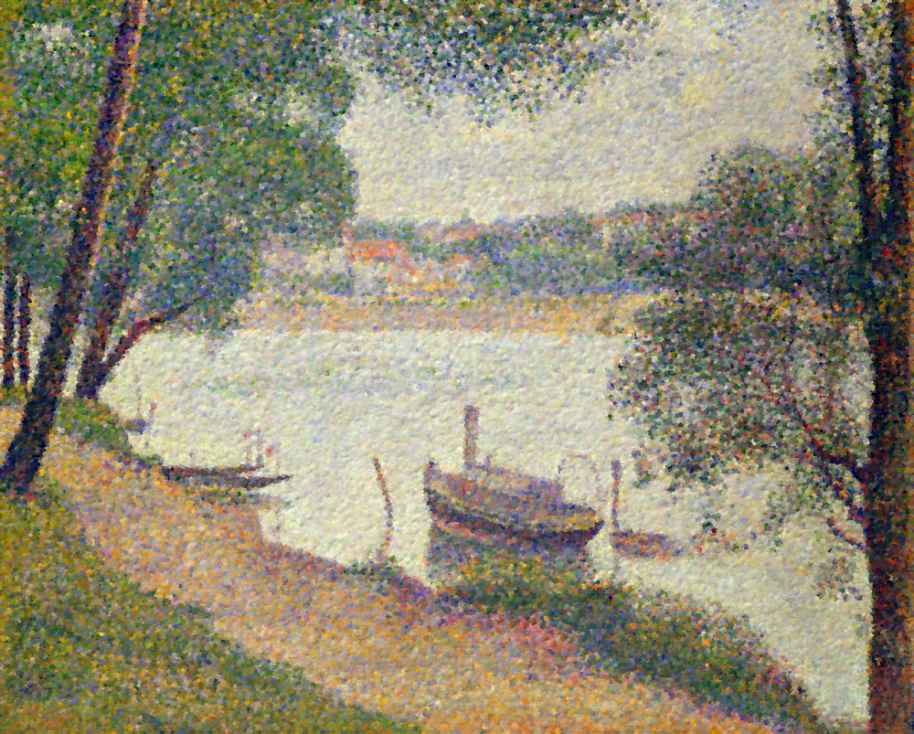

*After Seurat's* Gray Weather, Grande Jatte*: over a hundred thousand dots of
nearly pure colour, tapped on side by side.*

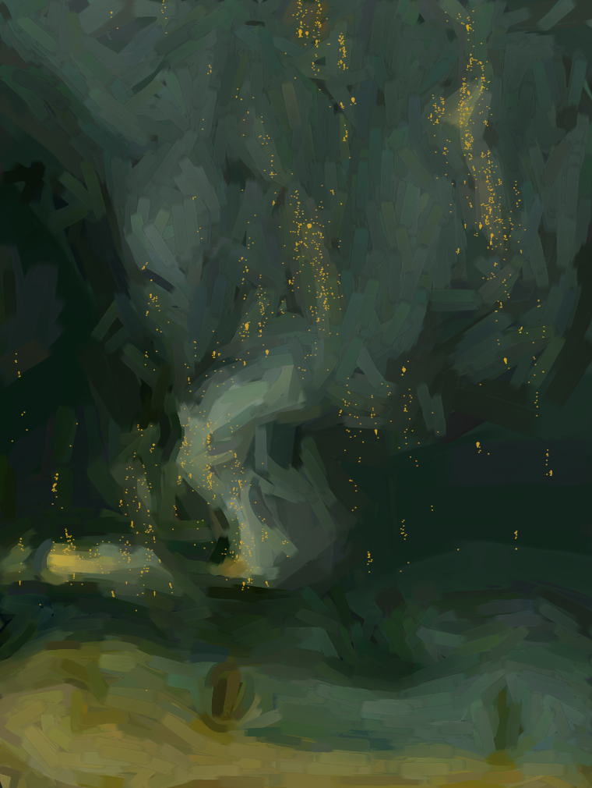

*After Whistler's* Nocturne in Black and Gold: The Falling Rocket*: thin washes
of night and smoke, and the falling sparks spattered on.*

## API

### `Paint(color, opacity=None, strength=None, name=None, body=None)`

* `color`: how the paint looks brushed out at normal thickness on white
  canvas. Use `"#rrggbb"`, a float triple in 0..1, or an int triple in 0..255
  (a triple with a component of 2 or more is read on the 0..255 scale, one
  whose largest component is between 1 and 2 is refused). It can also be a
  paint: `Paint(paint, ...)` is a copy with what you pass changed.
* `opacity`: 0..1, how much it hides what's underneath (default 1). 1 is a
  body color, ~0.3 a glazing color, 0 a pure dye.
* `strength`: tinting strength, i.e. how much it dominates mixtures (above 0,
  default 1; on a copy, it multiplies the paint's own).
* `body`: 0..1, how stiff the paint is (default 0.7, paint from the tube).
  Stiff paint holds the marks of the tool: ridges, peaks, bristle grooves.
  Fluid paint (thinned with medium) levels out smooth. See **Impasto** below.

Useful members:

* `Paint.mix((a, 1), (b, 3))` mixes paints by volume on the palette (a bare
  paint or colour counts as one part).
* `paint.appearance(thickness, over=color)` gives the color of a layer over a ground.
* `paint.masstone` is the color straight from the tube.
* `mix_colors(["#1b3fa0", "#f5d000"])` gives the hex color of a quick palette mix.
* `oilpaint.palette` has ready-made paints: `TITANIUM_WHITE`, `CADMIUM_YELLOW`,
  `ULTRAMARINE_BLUE`, `ALIZARIN_CRIMSON`, `PHTHALO_BLUE`, `BURNT_UMBER`, …
  It also has `MEDIUM`, a clear, fluid medium for thinning paint into a glaze:
  `Paint.mix((ALIZARIN_CRIMSON, 1), (MEDIUM, 3))`, and `IMPASTO_MEDIUM`, a
  stiff gel that makes paint hold sharp ridges: `Paint.mix((CADMIUM_RED, 2),
  (IMPASTO_MEDIUM, 1))`. Mixing averages the body by volume;
  `paint.with_body(0.9)` gives a stiffer copy.
* `palette.OLD_MASTER` is a 17th-century Dutch palette: `LEAD_WHITE` (warmer,
  more translucent and much stiffer than titanium white: it holds thick,
  broken lights), `LEAD_TIN_YELLOW`, `YELLOW_OCHRE`, `RED_OCHRE`, `VERMILION`,
  `RED_LAKE` (a transparent crimson), `RAW_UMBER`, `BURNT_UMBER`,
  `CASSEL_EARTH` (a transparent brown for glazing shadows), `BONE_BLACK` and
  `SMALT` (a weak, greyish blue).
* `palette.match(color, paints, max_paints=3, thickness=1.0, over="#ffffff")`
  mixes the given paints to match a colour, the way a painter does on the
  palette, with the same pigment physics as the canvas. It returns the mixed
  `paint`, the recipe `parts` and the `error` (CIELAB delta E):

  ```python
  from oilpaint import palette

  m = palette.match("#c89070", palette.OLD_MASTER, over="#5a4532")
  m.parts     # [(Lead White, 1.0), (Lead-Tin Yellow, 1.6), (Red Lake, 3.9)]
  m.error     # 0.6
  ```

  Match over the colour you will paint on: a transparent mix that only looks
  right over white won't be chosen then. Offering fewer paints (the ones you
  would use for flesh, say) gives more painterly recipes.

### `canvas.stroke(path, paint=None, amount=6, width=None, pressure=0.5, *, brush=None, **options)`

| parameter  | meaning |
|------------|---------|
| `path`     | List of `(x, y)` points: a smooth Catmull-Rom spline passes through them. Or a `CatmullRom`, `Bezier` (anchor, handle, handle, anchor, …) or `Polyline`. One point makes a dab: pressed firmly, a solid mark; tapped lightly (pressure below about 0.4), only the tips of the longest bristles touch and the mark breaks into dots (bushes, foliage; see `tips` and `canvas.stipple`), and a soft brush gives a dab feathered all round. |
| `paint`    | A `Paint` or a color. `None` uses a clean brush (blending), or the given `brush`. A list loads several paints: `[(paint, amount[, across[, depth]]), ...]` (see `Brush`). |
| `amount`   | Paint on the brush, in "brush widths of solid stroke": `amount=6` covers about 6 widths before the brush runs dry and starts to break up. Small brushes need bigger amounts to go as far (they also hold more for their size). Loading a brush beyond what its hair holds (roughly `amount` 10 to 15 and up for a brush 20 px or wider, depending on the hair) puts a glob of paint on it that goes on thick: impasto. The width it is measured in is the stroke's *mean* width, after any `taper` and along any width profile, so a tapered or narrowing stroke loads less paint for the same `amount` (`taper=0.3` about 58% of the same stroke untapered). Not used when `paint` is a list of loads, which carry their own amounts. |
| `brush`    | The tool: a `BrushType` (e.g. `brushes.FLAT_HOG`, see below), or a `Brush` that keeps leftover paint and dirt between strokes. Default: a medium round. |
| `width`    | Brush width in px; defaults to the brush's own size. A number, one value per control point, or `f(u)` with `u` in 0..1 along the stroke. `f` is called once with the array of all `u`; if it only takes one number (`lambda u: 30 if u < 0.5 else 10`), it is called for each `u` in turn. |
| `pressure` | 0..1, same forms as `width`. Light pressure lays paint *on top of* wet paint. Heavy pressure releases more paint and churns it *into* the wet paint below. Soft, pointed brushes also get wider under pressure. An overloaded brush pressed hard squeezes paint out into ridges at its edges. A knife's pressure sets how thick its slab is: light leaves it thick, hard scrapes close to the canvas. |
| `angle`    | Brush angle in degrees, same forms as `width`: 0 drags a flat broadside, 90 on its edge. Vary it to twist the brush mid-stroke. |
| `follow_path` | `True`: the angle turns with the stroke. `False`: the angle is fixed on the canvas, like a calligraphy nib. |
| `roll`     | Round brushes only: how far the brush is rolled between the fingers, in degrees, same forms as `width`. Rolling turns a different side of the bundle to the canvas (see `Brush`). |
| `mixing`   | How readily the stroke stirs into the wet paint below. |
| `pickup`   | How much wet paint the brush lifts and carries along (brushes; a knife drags wet paint instead). A brush barely touching lifts much less than one pressed into the paint. |
| `drag`     | How much wet paint the brush pushes ahead (brushes). |
| `smear`    | How long picked-up color lingers on the brush tip, roughly in widths. |
| `blending` | How readily the paints loaded on the brush merge into each other during the stroke. |
| `streaks`  | Strength of the brush-hair streak texture. |
| `taper`    | Feathered ends: fraction of the length where the brush is lowered/lifted, 0..1, or a `(start, end)` pair. |
| `lift`     | 0..1, how the tool leaves the paint at the end: 0 slides off cleanly; higher pulls the paint up as it goes. A knife pulls thick paint into streaks and torn ridges along the pull (1 gives a stucco-like texture). A brush's bristle clumps leave the paint one after another over the last stretch of the stroke, a ragged end, each pulling thick, stiff paint up into a crest as it goes. Default 0.3 for knives; for brushes, from the stiffness: about 1 for hog, 0 for sable and other soft hair (it closes up and slides off clean); given explicitly, it acts on any brush, strokes and dabs alike. |
| `seed`     | Seed for the stroke's texture: anything `np.random.default_rng` takes. By default it comes from the canvas's own random numbers, so a canvas made with a `seed` paints the same every time. |

`mixing`, `pickup`, `drag`, `smear`, `streaks`, `blending`, `taper`, `lift`,
`angle` and `follow_path` default to the brush type's own character; pass
them to override it for one stroke. `mixing`, `pickup`, `drag` and `streaks`
are clipped to 0..2, `blending` and `lift` to 0..1.

`stroke()` returns the `Brush` it used. You can also build a `Stroke(...)`
dataclass with the same fields and call `canvas.paint(stroke1, stroke2, ...)`.

Arguments are checked before anything is painted: a number that is not
finite, a negative width, a `taper` outside 0..1, a `brush` that is not a
`BrushType` or `Brush`, a malformed load or an empty path raises
`ValueError` or `TypeError` naming the argument. (A width or pressure
function is checked as the stroke samples it, still before any paint is
laid.)

A stroke can run off the canvas. The tool goes on past the edge as if the
canvas went on there, using up its paint as it would on canvas, so what
lands on the canvas is what the same stroke would leave on a larger canvas
(to within a few percent). The part off the canvas is simulated too, so it
takes about as long as it would on that larger canvas.

### Brushes

`oilpaint.brushes` is a rack of ready-made tools:

| preset | what it is |
|--------|------------|
| `ROUND`, `ROUND_HOG`, `ROUND_SABLE` | Rounds. Pointed rounds paint thin lines with a light touch and swell under pressure. |
| `LINER`, `RIGGER` | Ultra-fine rounds for outlines and long, fine lines (branches, rigging). `amount` is measured in brush widths, so load these generously, e.g. `amount=200` for a 500 px line. |
| `MOP` | Very large, very soft and absorbent: soft blending, feathered edges. |
| `DEER_FOOT` | A round cut on a slant, for stippling foliage and texture. |
| `FLAT_HOG`, `FLAT_SABLE` | Long flats: square ends, broad strokes, thin lines when turned on edge. |
| `BRIGHT` | A short, stiff flat: controlled strokes, pushes stiff paint. |
| `ANGLED`, `DAGGER` | Flats with bristles cut on a bias: the toe touches first; daggers taper sharply. |
| `BLENDER` | A wide soft flat for glazes and smooth gradients. |
| `FILBERT_HOG`, `FILBERT_SABLE` | Flats with an oval tip: broad strokes, or petals and leaves (press, then lift). |
| `FAN_HOG`, `FAN_SOFT` | Separate bristle clumps: grass, hair, foliage, or feathering. |
| `PALETTE_KNIFE`, `KNIFE_…`, `SCRAPER` | Painting knives: rigid steel blades of different shapes (see **Knives** below). |
| `RAG` | Lifts wet paint without laying any down: wipe out lights or correct mistakes. |
| `BRUSH_HANDLE` | The other end of the brush, scratched through wet paint (sgraffito): a groove down to the paint beneath, deeper with more pressure. |
| `STIPPLER` | A short, dense, flat-topped round, tapped straight down (`canvas.stipple`): clusters of dots for foliage, textures, broken colour. |

```python
from oilpaint import BrushType, brushes

canvas.stroke(path, "#1d3f9a", brush=brushes.FLAT_HOG)                 # 24 px hog flat
canvas.stroke(path, "#1d3f9a", brush=brushes.FLAT_HOG.sized(48))       # a bigger one
canvas.stroke(path, "#1d3f9a", brush=brushes.FLAT_HOG, angle=lambda u: 90 * u)   # twist into a ribbon

# make your own: shape + size + hair, then tweak any property
soft_flat = brushes.make("flat", 30, hair="sable", length=0.8)
grass_fan = brushes.make("fan", 40, hair="hog", clumps=12)
nib = brushes.FLAT_SABLE.with_(angle=40, follow_path=False)            # calligraphy
custom = BrushType(shape="filbert", width=26, aspect=0.45, stiffness=0.6, capacity=1.4)
```

`BrushType` fields:

| field | meaning |
|-------|---------|
| `shape` | Brushes: `round`, `flat` (square ends), `filbert` (flat with an oval tip), `fan` (spread of separate clumps). Knives: `trowel`, `pear`, `straight`, `angled`, `spoon`. |
| `width` | Default width in px (for a knife, the blade's length). |
| `aspect` | Footprint thickness relative to width: 1 for a round, ~0.2 for a flat. For a knife, the blade's width relative to its length. |
| `angle`, `follow_path` | Default orientation (see `stroke`). |
| `stiffness` | 0 = very soft (sable, squirrel) … 1 = very stiff (hog, knife). Stiff tools leave stronger ridges and ragged edges, push more paint and blend less. |
| `bristles` | Density: 0 = sparse and coarse (bold streaks, dry-brush breakup) … 1 = dense and fine (smooth). |
| `capacity` | How much paint sits in the tip: above 1 ("fat") the brush keeps colour it picked up and smears it further; below 1 it is quickly cleaned by its own fresh paint. (How far a stroke reaches is set by `amount`.) |
| `spread` | How much the brush widens under pressure. |
| `clumps` | Number of separate bristle clumps (fans), or teeth on a comb knife. |
| `slant` | Bristles cut on a bias (angled ~0.5, dagger ~0.9): the toe touches first. |
| `softness` | Feathered edges and ends (mops, blenders). |
| `taper` | Default feathered ends for strokes made with it. |
| `deposits` | `False` for tools that only lift paint (the rag). |
| `dig` | 0..1: how deep a point cuts into the wet paint under it (1: down to the dry paint or canvas), pushing it aside into low ridges (the brush handle). |
| `blending` | How readily different paints loaded on the brush merge as it is used. |
| `tips` | How many separate tips (clumps of bristle ends) a dab prints when the brush is tapped lightly; 0 works it out from the size and the hair (fine hair: more, smaller tips). A light tap touches only the longest; harder taps bring in more until the mark closes up. Each brush keeps its own layout, turned a little on every tap. |
| `streaks`, `pickup`, `drag`, `mixing`, `rough` | Explicit overrides of the behavior otherwise derived from stiffness and bristles. |

`brushes.make(shape, width, hair, length)` picks sensible values from the
hair (`hog`, `mongoose`, `synthetic`, `sable`, `squirrel`) and the bristle
length (0 = short like a bright: stiffer, smaller tip capacity; 1 = long:
springier, larger tip capacity). `brushes.catalog()` lists the presets.

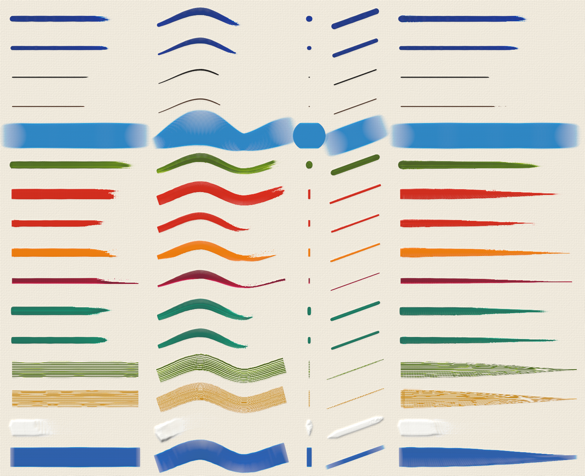

*Sixteen of the presets, top to bottom: `ROUND`, `ROUND_SABLE`, `LINER`,
`RIGGER`, `MOP`, `DEER_FOOT`, `FLAT_HOG`, `BRIGHT`, `ANGLED`, `DAGGER`,
`FILBERT_HOG`, `FILBERT_SABLE`, `FAN_HOG`, `FAN_SOFT`, `PALETTE_KNIFE` and
`BLENDER`. Each makes a straight stroke, an S with light → heavy → light
pressure, a dab, a stroke on the brush's edge, and a stroke that twists from
broadside to edge-on.*

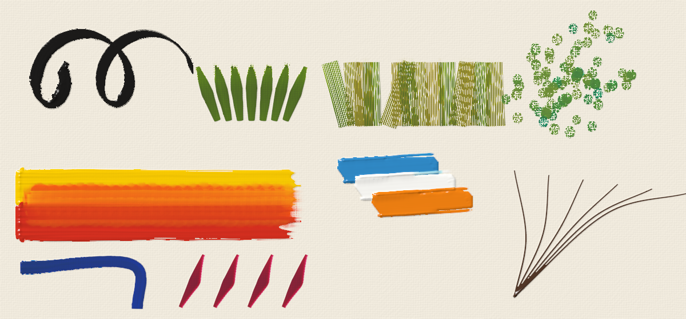

*Calligraphy with a flat at a fixed angle, filbert leaves, hog-fan grass,
deer-foot stippling, a mop blending two wet colors, palette-knife slabs, rigger
branches, an angled flat cutting a corner, dagger strokes.*

### Dabbing and spatter

Some marks aren't brushed at all: they are tapped, pressed or flicked.

* `canvas.stipple(points, paint, amount=6, width=None, pressure=0.3, brush=STIPPLER)`
  taps one brush straight down at each point in turn, without reloading it,
  so it runs out as it goes; it turns a little on every tap. Tapped lightly,
  a bristle brush prints only the tips of its longest bristles: sparse dots
  that fill in as the pressure rises (`tips` sets how many). `pressure` can be one value per
  point. Returns the brush.
* `canvas.spatter(at, paint, amount=1, direction=0, spread=25, reach=120, size=3, seed=None)`
  flicks paint off a loaded brush: a spray of drops leaving from `at` (a
  point, or a path the brush sweeps along as it is flicked), flying
  `direction` degrees (0 to the right, 90 down the canvas), fanned out by
  about `spread` degrees and landing about `reach` px away, sparser further
  off. `size` is a typical drop's diameter: most are smaller, a few much
  bigger, with little satellites. Drops landing head-on stay round; those
  flying further come in at a slant and stretch into teardrops, their narrow
  tails pointing the way they flew. They sit on top of wet paint. `amount` 1
  is a good flick, about 120 drops. Returns the number of drops that land on
  or by the canvas (0 with no paint).

```python
from oilpaint import brushes

canvas.stipple(points, "#3c6e2f", amount=12, pressure=0.25)               # stippled foliage
canvas.spatter((80, 400), "#f2c230", direction=-20, spread=15, reach=250, size=1.5)  # a fine flick
```

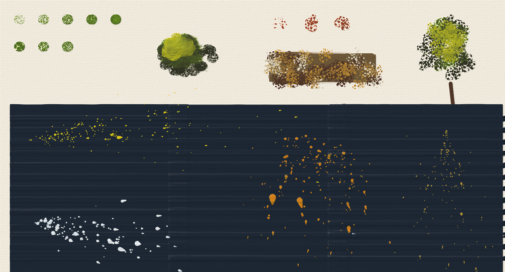

*Top left: the stippler tapped from light to firm, then with 10, 40 and 160
tips at the same pressure, and a bush stippled dark to light. Top right: a
rock face stippled light over a dry umber ground with a bigger stippler, and a
stippled tree. Bottom, on a dark wash: a fine flick of yellow, a coarse one of
white, orange flicked from a brush swept along as it went, and a shower of
ochre falling straight down.*

### Painting from a reference: `Reference(image, width, height, box=None)`

A photo, a sketch or a painting to study, fitted to the canvas. It answers
what a painter looks for before each stroke, at the scale of the brush:

| method | answer |
|--------|--------|
| `color(x, y, scale=0)` | The sRGB colour there, softened over `scale` px (a big brush sees big shapes). |
| `value(x, y, scale=0)` | The lightness there (CIE L*, 0..1). |
| `direction(x, y, scale=4)` | `(angle, strength)`: which way the forms run there (along edges and lines of equal light), so strokes can follow the form, and how clear that is. |
| `detail(x, y, scale=4)` | How busy it is there: a cue for a smaller brush. |
| `trace(x, y, length, scale=4, tolerance=0.08, bend=1.0)` | A curved stroke path from the point, following the forms while the colour stays the same. |

All of them take arrays of points as well.

```python
from oilpaint import Reference, palette

ref = Reference("portrait.jpg", canvas.width, canvas.height)
x, y = 420, 310
path = ref.trace(x, y, length=60, scale=6)
paint = palette.match(ref.color(x, y, 6), palette.OLD_MASTER, over="#5e4430").paint
canvas.stroke(path, paint=paint, width=14)
```

### `Canvas(width, height, ground=None, texture=None, weave=None, seed=None, surface=None, reverse=False)`

* `surface` is what you paint on (see **Surfaces** below). Default: a
  generic primed canvas.
* `ground` overrides the surface's priming color, or is an `(H, W, 3)` sRGB
  image to paint over (floats in 0..1, or whole numbers in 0..255). `texture`
  and `weave` are shortcuts for the surface's `relief` and `scale`.
* `seed` seeds the surface and the strokes' textures: the same seed and the
  same strokes paint the same canvas.
* `reverse=True` paints on the back of a clear support (`surfaces.GLASS`)
  and shows it through the front: a reverse glass painting (see **Reverse
  glass** below).
* `canvas.dry()` lets everything dry. Later strokes stop mixing with it and
  glazes layer over it optically.
* `canvas.copy()` (or `copy.copy(canvas)`) is an independent copy: paint on
  it, or let it dry, and the original stays as it was. The copy paints on
  exactly as the original would. Canvases also pickle.
* `canvas.render(lighting=True, light=(-0.6, -0.8, 1.1), relief=1.0, gloss=1.0)`
  returns an `(H, W, 3)` sRGB float image in 0..1, lit to show impasto and
  the surface texture as if photographed under a studio lamp: shading of the
  relief, soft cast shadows, darker grooves and hollows, and the gloss of
  oil: sharp highlights on the crests and lips of thick wet paint, duller
  once dry, while thin paint stays matte. Flat paint keeps its colour.
  `light` is the direction of the lamp (x, y, z; y points down the image;
  z must be positive, or `ValueError`): a smaller z rakes across the surface
  and brings out the relief (the impasto images here use
  `(-0.6, -0.8, 0.7)`). `relief` scales the height of the paint, `gloss` the
  highlights (0 for none; neither may be negative). `lighting=False` gives
  the flat colour, without relief, and ignores the other three; `light=None`
  is the default lamp.
* `canvas.surface_height(relief=1.0)` is the height map used for lighting,
  in pixels.
* `canvas.save("out.png", **render_options)` and `canvas.to_pil()` export the image.
* `canvas.color_at(x, y)`, `canvas.thickness`, `canvas.wet_thickness` and
  `canvas.reflectance()` let you inspect the paint.

### Surfaces

`oilpaint.surfaces` has ready-made supports:

| preset | what it is |
|--------|------------|
| `CANVAS` | The original generic primed canvas (the default). |
| `LINEN_FINE` | Fine, oil-primed linen: irregular threads with slubs, moderate tooth, barely absorbent. |
| `LINEN_COARSE` | Coarse linen: big uneven threads; a lightly dragged stroke breaks up on them (scumbling). |
| `COTTON_DUCK` | Cotton with acrylic gesso: an even, mechanical weave; bright and slightly absorbent. |
| `CANVAS_BOARD` | Fine cotton on card: light, even texture; fairly absorbent. |
| `OIL_PAPER` | Felted paper fibres with a pronounced tooth; absorbent. |
| `GESSO_PANEL` | Oak panel with a chalk gesso, as used by the Flemish masters: smooth, very absorbent, with priming brushmarks and a hint of wood grain. |
| `COPPER` | Glass-smooth and very slick; nothing is absorbed; the warm metal glows through thin paint. |
| `GLASS` | Clear glass: perfectly smooth, the slickest of all (paint wipes off clean), nothing absorbed. Its `ground` is what shows through it, a white backing card by default. Paint it on the front, or on the back as a reverse glass painting. |

```python
from oilpaint import Canvas, Surface, surfaces

canvas = Canvas(1200, 800, surface=surfaces.GESSO_PANEL)
canvas = Canvas(1200, 800, surface=surfaces.LINEN_FINE.with_(toning="#c49a6c"))      # toned ground
canvas = Canvas(1200, 800, surface=Surface(texture="twill", scale=5, tooth=0.6, absorbency=0.3))
```

`Surface` fields:

| field | meaning |
|-------|---------|
| `texture` | `linen`, `cotton`, `twill`, `paper`, `wood`, `smooth`, or `canvas` (the original weave). |
| `scale` | Texture size in px: thread spacing, paper tooth, or wood-ring spacing. |
| `irregularity` | Woven textures: 0 = perfectly even threads … 1 = very irregular. |
| `angle` | Wood-grain direction in degrees. |
| `relief` | How deep the texture is, under the light and through thin paint. |
| `tooth` | 0..1, how much the surface grips the brush. A rough tooth breaks up lightly pressed or dry strokes and pulls paint off the brush; a smooth one lets strokes glide unbroken. |
| `absorbency` | 0..1, how much the priming drinks oil. Paint drags, blends less and runs out sooner on an absorbent ground, and thin paint "sinks in": it goes matte, and darks look lighter and duller. |
| `slickness` | 0..1, how freely wet paint slides and lifts off the bare surface. Paint wipes cleanly off a slick surface and leaves a stain in an absorbent one. 0.5 is neutral. |
| `ground` | Priming color. |
| `toning`, `toning_strength` | A transparent toned layer (imprimatura) brushed over the priming. |
| `priming_marks`, `priming_angle` | Visible brushmarks in the priming, and their direction. |
| `transparent` | A clear support: `ground` is what shows through it, and it can be painted from the back (`Canvas(..., reverse=True)`). |

`surfaces.catalog()` lists the presets. Scales assume about 1 px ≈ 0.3 mm;
use `.with_(scale=...)` to match other canvas sizes.

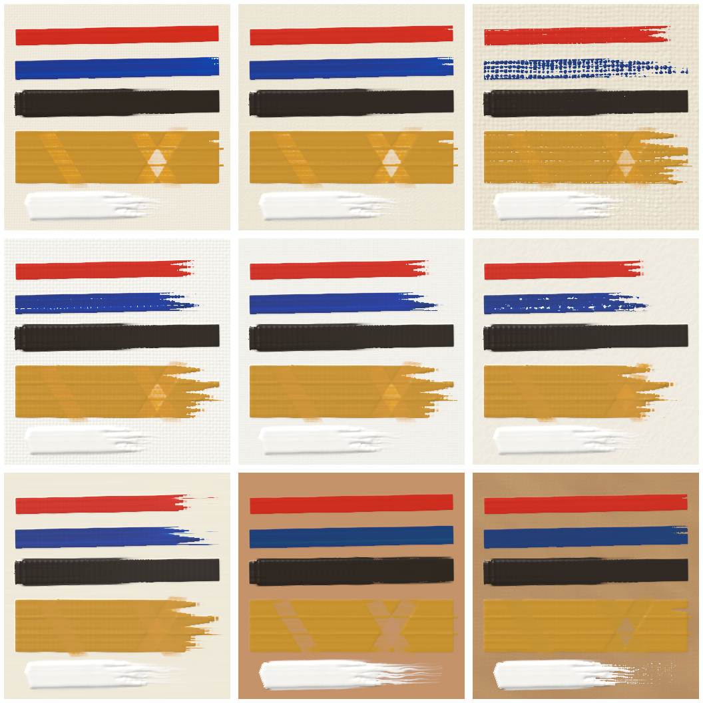

*The same marks on each surface, left to right and top to bottom: canvas, fine
linen, coarse linen, cotton duck, canvas board, oil paper, gesso panel, copper,
glass (over a white card), and fine linen with a toned ground. The marks are: a
loaded hog flat, the same brush dragged lightly (it breaks up on coarse linen
and paper), a dark (it sinks in on absorbent grounds), an ochre patch wiped back
with the `RAG` tool (clean on copper and glass, a stain on gesso and paper), and
a palette-knife slab.*

#### Reverse glass

A reverse glass painting is painted on the back of a sheet of glass and
looked at through the front, so the first paint laid is the one in front.
The painter works backwards: the outlines and the details first, then the
colours, and the background last. Each layer dries before the next goes on,
or the brush would smear what is already there. The colours can go on loosely
behind the outlines, since the lines in front hide the edges. Seen through the
glass, the paint is flat and glossy: brush marks and impasto stay on the back.
It was a folk art in Bavaria, Bohemia and Romania. Kandinsky and Gabriele
Münter took it up in Murnau around 1910, and Ivan Generalić and the Hlebine
school in Croatia made it their main medium.

```python
from oilpaint import Canvas, brushes, surfaces

glass = Canvas(800, 600, surface=surfaces.GLASS, reverse=True)
# the outlines first ...
glass.stroke(outline, "#1b1a19", amount=20, brush=brushes.LINER)
glass.dry()
# ... the colours behind them ...
glass.stroke(petal, "#d63a1f", amount=10, brush=brushes.FILBERT_HOG)
glass.dry()
# ... and the background last, all over
for y in range(0, 600, 20):
    glass.stroke([(0, y), (800, y)], "#7a9fd8", amount=16, brush=brushes.FLAT_HOG)
```

Coordinates are as seen from the front, so nothing has to be painted mirrored.
`ground` is what shows through where there is no paint: Kandinsky put black
card behind his glass paintings to deepen the colours
(`surfaces.GLASS.with_(ground="#151515")`).

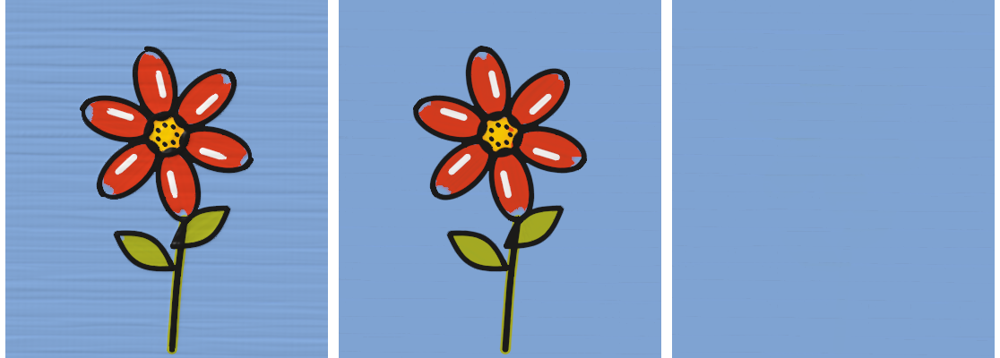

*The same flower painted three ways. Left: on the front of the glass, in the
usual order (background, colours, details, outlines); the brush marks show in
the light. Middle: on the back, in reverse order (outlines, details, colours,
background), seen through the glass: the same picture, flat and crisp, the
colours tucked behind the lines. Right: on the back, in the usual order: the
background went on first, so it is in front and hides everything else.*

### `Brush`: loading one or several paints

A `Brush` is one physical brush with paint on it: a `BrushType` plus its
current load and dirt. Paint sits in narrow bristle columns across the brush,
each in three layers from the point to the ferrule: the tip, the belly and the
heel. So a brush can carry several paints at once: side by side, tip over
belly, deep in the heel, or only partly mixed. It keeps them (and any paint it
picks up) between strokes. On a round brush the columns go around the bundle,
so it has a front and a back that you can turn to the canvas by rolling it.

```python
from oilpaint import Brush, brushes, palette as P

brush = Brush(brushes.FLAT_SABLE)
brush.load(P.CADMIUM_RED, amount=8)                        # the whole brush
brush.load(P.TITANIUM_WHITE, amount=3, across="left")      # double-load one side
brush.load(P.CADMIUM_YELLOW, amount=0.5, depth="tip")      # touch the tips into yellow
brush.work(1)                                              # stroke it on the palette to soften the join
canvas.stroke(path1, brush=brush)
canvas.stroke(path2, brush=brush)                          # carries on with what's left
brush.clean()

# or in one call
canvas.stroke(path, brush=brushes.FLAT_SABLE,
              paint=[(P.CADMIUM_RED, 8), (P.TITANIUM_WHITE, 3, "left"), (P.CADMIUM_YELLOW, 0.5, None, "tip")])

# several paints picked up together, only partly mixed: a marbled stroke
Brush(brushes.FILBERT_HOG).load_mix([(P.CADMIUM_RED, 1), (P.TITANIUM_WHITE, 2)], amount=8, mixing=0.3)

# a round with red on one side and yellow on the other, rolled one full turn along the stroke
rnd = Brush(brushes.ROUND).load(P.CADMIUM_RED, 10, across="left").load(P.CADMIUM_YELLOW, 10, across="right")
canvas.stroke(path, brush=rnd, roll=lambda u: 360 * u)

# dipped all the way to the ferrule: part of the paint lodges in the heel
deep = Brush(brushes.FLAT_HOG).load(P.BURNT_SIENNA, 8, depth=1.0)
canvas.stroke(path1, brush=deep, pressure=0.4)             # runs dry early
canvas.stroke(path2, brush=deep, pressure=0.95)            # pressing hard squeezes some out of the heel
```

| method / setting | meaning |
|---|---|
| `load(paint, amount, across=None, depth="belly", *, width=None)` | `across` says where on the brush: `"left"`, `"right"`, `"center"`, `"edges"`, `("left", 0.3)` (leftmost 30%), `(0.2, 0.6)` (a band, 0 = left edge, 1 = right edge), a function of x in 0..1, or one weight per column. Left and right are the brush's own sides, as seen looking along the stroke. On a round, `"left"` and `"right"` are the two sides of the bundle; `roll` then turns them. `depth`: `"tip"` (just touched: comes off first), `"belly"` (dipped in normally: the bulk of the load), `"heel"` (worked up to the ferrule), or a number, how far the brush went into the paint, 0..1 of the hair length: `0.1` loads the tip, `0.5` tip and belly, `1.0` all three layers. `width` (by keyword) is the stroke width in px that `amount` is measured in; by default `brush.width`, which each stroke sets to its own mean width. |
| `load_mix(parts, amount, mixing=0.5)` | Several paints picked up together. `mixing` 1 = fully mixed (like `Paint.mix`), lower = left in streaks across the bristles, so the stroke comes out marbled. Also takes `across`, `depth` and `width` as `load` does, and a `seed` for the streaks; without one, the same load on the same brush gives the same streaks. |
| `work(passes, pressure=0.5)` | Stroke the brush back and forth on the palette without painting: its paints blend side to side, tip with belly, and a little with the heel. |
| heel | Paint in the heel doesn't flow out by itself. Some of it is squeezed into the belly when the brush touches down (more when pressed hard) and whenever the pressure increases during a stroke; the rest stays in the brush until it is cleaned. It also counts in `brush.volume` and `brush.colors("heel")`. |
| `BrushType.blending` / `Stroke(blending=...)` | How readily the paints on the brush merge as it is used (0..1). Low keeps a double-loaded brush crisply two-toned for a long stroke (soft synthetic flats); high blends within a few widths (scrubby hog). Pressure speeds it up. Default: from stiffness. |
| `brush.colors(depth="all")` | The colour of each bristle column, left to right (around the bundle on a round): what is on the brush now. `depth` can be `"tip"`, `"belly"`, `"heel"` or `"all"`. |

What painters do with it:

* **Double loading** (one-stroke painting): a flat loaded with a dark on one
  side and a light on the other models a form in a single stroke: petals,
  leaves, ribbons, folds of cloth, the lit and shaded side of a branch.
  Twisting the brush half a turn (`angle` from 0 to 180) flips which colour
  leads: a folded ribbon or a curling leaf.
* **Triple loading**: three bands across a wide flat for skies, sunsets and
  water in one sweep.
* **Tip loading**: dip the tip in a second colour for strokes that start with
  one colour and change into another: leaves with yellow tips, highlights that
  melt into the local colour.
* **Brush mixing / broken colour**: pick up two or three paints without fully
  mixing them (`load_mix`, low `mixing`): marbled, vibrating strokes, as in
  Sargent or the Impressionists.
* **Softening the join**: `work()` on the palette, a higher `blending`, or more
  pressure, from a crisp edge to a smooth gradient across the stroke.
* **Dirty brush**: not cleaning between strokes carries colour from one area
  into the next for colour harmony; paint picked up from the canvas stays on
  the side of the brush that touched it. How long it lasts follows from the
  amounts: a brush that went through thick wet paint, or pressed hard into
  it, or held little paint of its own, stays dirty longer than a full brush
  that skimmed a thin film.
* **Fans and knives**: a double-loaded hog fan puts light and dark blades in
  every flick of grass; a double-loaded palette knife lays two-tone slabs.
* **Rolling a round**: rolling the brush between the fingers as it moves
  turns a different side of the bundle to the canvas. With two or three
  colours loaded around it, a slow roll moves the colours from one edge of the
  line to the other, and a quick roll twists them into a spiral: branches,
  twigs, ropes, twisted cloth. Rolling also keeps the brush from flattening
  and brings fresh paint from the back to the front.
* **Dip depth**: a brush dipped only at the tip lays a short, clean stroke and
  cleans easily. Dipped to the ferrule, part of the paint lodges in the heel:
  the stroke runs dry sooner, but pressing hard later squeezes more paint out
  (scrubbing, or reviving a stroke that is breaking up). Leftover paint in the
  heel also tints later strokes until the brush is cleaned, which is why
  painters avoid loading to the ferrule.
* **Layered loads**: a dark worked deep into the brush, a mid-tone in the
  belly and a light touched on the tip come out one after the other: one
  stroke that starts light and darkens, or a stroke you can revive with a
  darker colour by pressing.

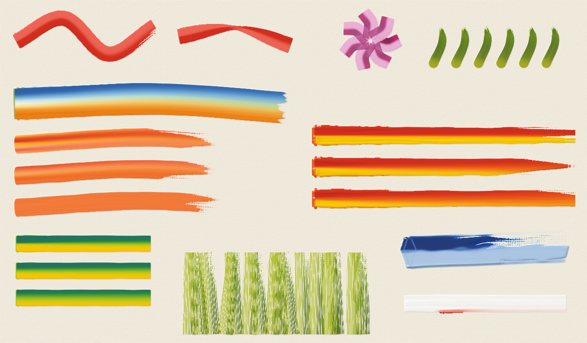

*Top: a double-loaded flat (red with a white edge), the same twisted half a
turn, one-stroke petals, tip-loaded leaves. Then a triple-loaded sky stroke;
partly mixed pickups at mixing 0.15, 0.45 and 1.0 (left); the same red/yellow
double load at blending 0.05, 0.4 and 1.0 (right); a viridian/yellow load
worked 0, 2 and 6 times on the palette; double-loaded fan grass; a two-tone
knife slab; and a white stroke whose lower side picked up wet red.*

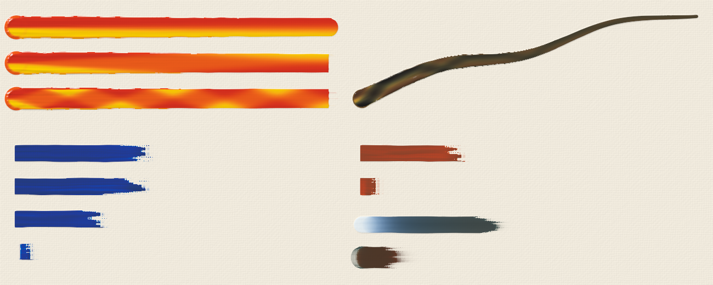

*Top left: a round loaded red on one side and yellow on the other, not
rolled, rolled half a turn, and rolled three turns along the stroke. Top
right: a hog round loaded with umber, ochre and black around the bundle,
rolled back and forth along a tapering branch. Bottom left: the same amount of
blue on a flat dipped to 0.1, 0.5 and 1.0 of its length, and worked into the
heel only. Bottom right: a flat dipped to the ferrule, painted once lightly
and then pressed hard (only the squeezed-out heel paint comes off); a round
with umber in the heel, blue in the belly and white on the tip, painted once,
then pressed hard to squeeze out the umber.*

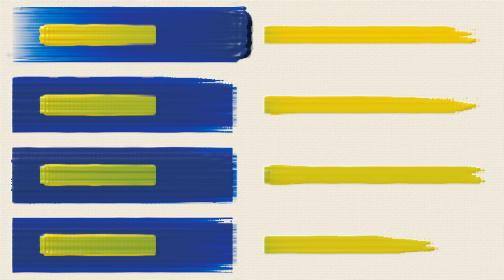

*A dirty brush. A flat full of yellow is dragged through wet blue (left),
then lifted and used again on clean canvas without new paint (right). From
the top: blue scraped back to a thin film, a medium layer, a thick one (two
layers), and the medium layer again with the brush pressed hard. The thin
film only dirties the tips, and the next stroke is soon clean yellow again.
Thicker paint, or pressing harder, gets further up into the brush, and the
next stroke stays greenish all along. Through the thicker layers, and
pressed hard, the brush also ploughs the blue: the yellow is marbled with
it.*

### Impasto: thick paint and relief

Thin paint gives colour; thick paint also gives shape. Paint has a height on
the canvas, and the tools push it around:

* **Load.** A normal load lays a normal film. Beyond what the hair holds, the
  extra sits on the brush as a glob that goes on thick (twice the load, about
  twice as thick), and the bristles comb it into grooves and ridges.
* **Bristle furrows.** The clumps of bristles that comb the paint are a
  physical size (coarser for hog than for sable), so a big brush combs more
  furrows, not bigger ones. Along the stroke the clumps drift sideways,
  crowd together and part, and the brush regroups now and then: a furrow
  lasts a brush width or two, merges with its neighbour, splits or fades,
  and the edges of the stroke are ragged rather than ruled.
* **Setting down and lifting off.** An overloaded brush set down squeezes a
  lumpy bead of paint out behind and beside where it landed. At the end a
  stiff brush leaves the paint one clump after another (a ragged end, over a
  stretch set by how far its bristle tips travel as it comes up: barely
  longer on a wide brush, and different on every stroke), and each clump
  thins out and pulls thick, stiff paint up into a crest just behind its tip
  (`lift`); a soft brush slides off clean.
* **Dabs.** An overloaded brush pressed down leaves part of its glob as a
  lumpy mound (flatter the harder it is pressed), and lifted straight off it
  pulls the paint up into a peak or two. Tapped lightly, a full brush's glob
  touches all over rather than printing only its bristle tips.
* **Pressure.** Pressing an overloaded brush or knife squeezes paint out at its
  edges into ridges: as wide as the paint in them makes them, steep against
  the stroke, swelling and breaking where the clumps at the brush's edge
  pushed them out. Light pressure leaves a thick deposit; heavy pressure
  spreads it thin and pushes the excess aside. Only paint near the edges of
  the brush gets out, though: under a brush wider than about 40 px, paint
  more than 20 px in from the nearer edge mostly stays where it is, so a
  wide, heavily loaded stroke stays thick and furrowed in the middle, and
  its ridges and the bead where it was set down stand no taller for its size
  than a small brush's.
* **Ploughing.** Dragging a tool through thick wet paint pushes the paint above
  it aside into ridges and ahead of it, and leaves a pile where it lifts.
  Pressed hard (from a pressure of about 0.4, fully from 0.6) through wet paint
  thicker than about 1.5 units and stiff enough to hold a groove (a `body`
  near that of tube paint, 0.7: softer paint flows back in), a brush
  doesn't ride on its own load: its bristles go down through it, cut the old
  paint away (deeper along the lines of their clumps), push much of it up
  into ridges beside the stroke (a wide brush, only what lies near its
  edges: it leaves the rest where it is) and lay the new paint more into their
  grooves; once the stroke has passed, the old paint left between the grooves
  folds up over the new in proportion. That is wet-in-wet marbling: a white
  hog flat pressed hard through thick wet blue comes out streaked with tints
  from white to blue, where a light touch lays an even, bluish white over it.
  The stiffer the hair, the more: soft hair bends and slides over the paint
  and leaves a trace, a synthetic ploughs about half as much as a hog, and
  the lanes follow the brush's own clumps. How far the old paint folds over
  the new goes with the brush's `mixing`: with none, the stroke is ploughed
  but not marbled. A drop of spatter has no bristles and never ploughs.
* **Body.** How long the marks last depends on the paint's `body`. Paint thinned
  with `MEDIUM` flows and levels out; tube paint keeps its bristle marks,
  their sharpest crests rounding off a little where it lies thick; paint
  stiffened with `IMPASTO_MEDIUM` holds sharp ridges. Even stiff paint
  slumps a little where it stands as a sheer cliff.

```python
from oilpaint import Paint, brushes, palette as P

# an overloaded hog flat, pressed firmly: bristle grooves, ridges along both edges
canvas.stroke(path, P.CADMIUM_RED, amount=45, brush=brushes.FLAT_HOG.sized(36), pressure=0.8)
# the same load thinned with medium: smooth, almost no relief
canvas.stroke(path, Paint.mix((P.CADMIUM_RED, 1), (P.MEDIUM, 3)), amount=45, brush=brushes.FLAT_HOG.sized(36))
canvas.save("impasto.png", light=(-0.6, -0.8, 0.7))     # a raking light shows the relief
```

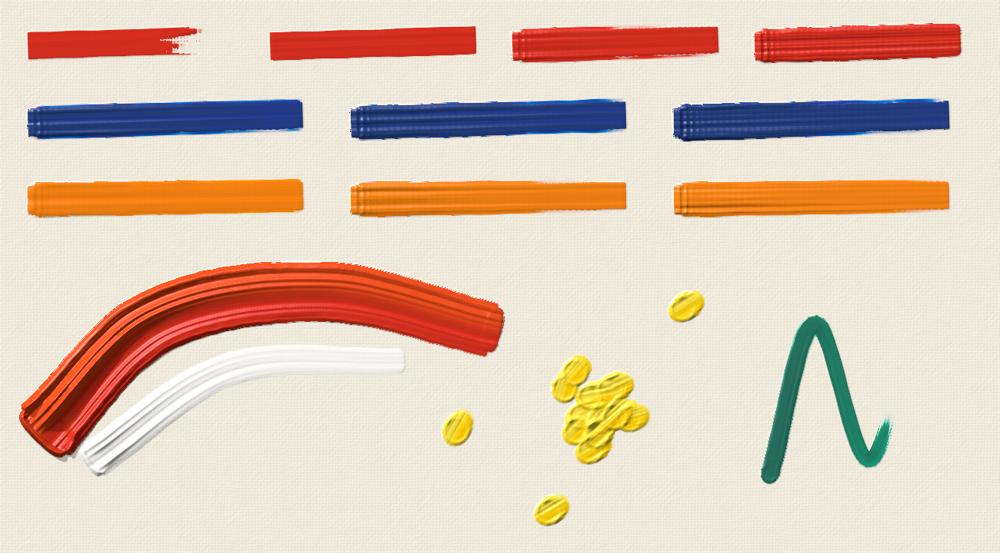

*Top: the same hog flat loaded with `amount` 6, 15, 30 and 60. The colour is
the same; the relief grows. Second row: an overloaded flat (`amount=45`) at
pressure 0.2, 0.55 and 0.9, squeezing more and more paint into ridges at its
edges. Third row: the same load of orange thinned 1:3 with medium (levels
out), straight from the tube, and stiffened with impasto medium (crisp
grooves). Below: a heavily loaded two-colour filbert with white dragged
through it wet, thick dabs with a hog round, and an overloaded round.*

### Knives

A painting knife is a rigid steel blade. It doesn't hold paint in hair: the
paint is a film under the blade, and the blade rides on it. Everything under
the blade is filled up to the blade and everything above it is pushed away, so:

* **Pressure sets the thickness.** A light touch leaves a thick, smooth slab with
  crisp edges. Pressing harder lays it thinner, with the excess squeezed into
  lips along the sides. Pressing hard scrapes close to the canvas: the
  blade rides on the tops of the threads and the paint is left only in the
  weave.
* **Barely touching** (pressure below about 0.3), the blade skims: only the
  bead of paint on its edge touches the high points of what is underneath,
  in streaks along the blade's nicks and on the threads. That is how snow
  goes on a mountain over the wet dark ("let it break").
* **Running out.** As the paint under the blade runs low the blade sinks: the
  slab thins out and finally only catches the high points, tearing into a
  streaky tail with the canvas showing through. A smaller load gives a
  stroke that starts thick and tears out before it ends.
* **Colour streaks.** Paint on a blade isn't held in lanes the way bristles hold
  it: two or three paints loaded side by side (or picked up partly mixed with
  `load_mix`) come out as bands that waver and merge along the stroke.
* **Over wet paint.** The blade rides on the wet paint already there and sinks
  into it the harder you press (less into stiff paint). A light touch lays a
  clean skin of new colour on top without mixing. Harder pressure cuts into
  the paint below, pushes it into ridges and drags it along. Where the blade
  cuts into the lower layer, the two fold into each other in streaks.
* **A dry knife dragged across.** Say white knifed over wet purple, then a clean
  knife pulled from the white out across its edge into the purple:
  * a light touch skims and pulls a few streaks of white across;
  * a firm one drags the white out over the purple in a smear that fades
    from white through lavender to purple;
  * pressing hard scrapes a channel down through both layers and carries
    the mixture along, piling it where the knife lifts.

  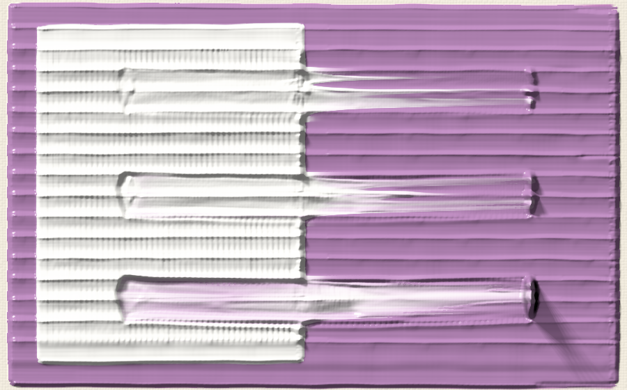

  *A thick purple field with white knifed over its left half while wet, then
  a clean knife dragged from the white out into the purple at pressure 0.3,
  0.6 and 0.9.*
* **Over dry ridges.** The blade skims the high points and leaves the hollows:
  broken colour.
* **Blade ends.** Near the two ends of the blade, paint is pressed out
  sideways into a ridge along each edge of the slab, more the harder it is
  pressed.
* **Nicks.** Nicks and grit on the blade's edge score nearly straight lines
  along the stroke, which come and go as grit catches and paint closes over
  them.
* **Lifting off.** A knife lifted off thick paint pulls it up into torn ridges
  and peaks along its trailing edge (`lift`).
* **Comb knives.** The teeth score grooves into wet paint and push it into
  ridges between them (sgraffito).
* **Edge lines.** For lines with the edge of the blade, use a blade with a tiny
  `aspect` (the blade held upright, only its edge touching) and dab it. For
  example, `canvas.stroke([(x, y)], paint, amount=80,
  brush=brushes.KNIFE_STRAIGHT.with_(aspect=0.04), angle=80,
  follow_path=False)` lays a line the length of the blade at 80° from
  horizontal: grass, stems, masts.

| preset | blade | for |
|--------|-------|-----|
| `PALETTE_KNIFE` | medium diamond trowel | the all-rounder: slabs pulled sideways, petals with the tip |
| `KNIFE_TROWEL` | large trowel | covering areas with thick, flat planes of colour |
| `KNIFE_SMALL` | small trowel | details, small petals and leaves, dots, highlights |
| `KNIFE_PEAR` | teardrop, round tip | rounded petals and dabs |
| `KNIFE_STRAIGHT` | long straight blade | long sharp edges, lines on its edge, skies, scraping |
| `KNIFE_ANGLED` | end cut on a slant | crisp angled edges, corners |
| `KNIFE_SPOON` | small oval | round dabs, flower centres |
| `KNIFE_COMB` | serrated edge | parallel grooves scored into wet paint |
| `SCRAPER` | wide, stiff | scraping back to the canvas, big flat planes |

```python
from oilpaint import brushes

canvas.stroke(path, "#e8c040", amount=40, brush=brushes.PALETTE_KNIFE, pressure=0.3)   # a thick slab
canvas.stroke(path, "#e8c040", amount=40, brush=brushes.PALETTE_KNIFE, pressure=0.9)   # scraped thin
# a petal: the flat of a pear knife pressed down at the outer edge and pulled in towards the
# centre, easing off: the mark narrows as less of the blade touches
canvas.stroke([(outer_x, outer_y), (centre_x, centre_y)], paint=[("#f6f5f0", 10), ("#f7c600", 3, "right")],
              brush=brushes.KNIFE_PEAR, angle=10, width=[36, 12], pressure=[0.3, 0.55])
# a swatch that tears out: partly mixed paints, not too much of them
from oilpaint import Brush
knife = Brush(brushes.PALETTE_KNIFE.sized(90)).load_mix([("#b8246e", 2), ("#f6f5f0", 1)], 12, mixing=0.25)
canvas.stroke([(430, 100), (60, 102)], brush=knife, pressure=[0.25, 0.55])
# make your own: shape, blade length, flexibility (0 stiff .. 1 very flexible), teeth
my_knife = brushes.knife("trowel", 50, flex=0.7)
```

Do the different knives make a difference? Yes, though less than the way
they're held:

* **Shape.** The blade's outline is the shape of the mark. A diamond trowel
  leaves pointed ends and a pear leaves rounded ones. A long straight blade
  gives long straight edges and lines.
* **Size.** The blade's size sets the scale: a small trowel for petals and dots,
  a large one or a scraper for planes.
* **Flexibility.** A flexible blade bends under pressure, follows the surface
  and spreads thinner. A stiff one rides on the high points, lays thicker
  slabs and scrapes cleanly.
* **Handle.** A cranked (offset) handle keeps the knuckles out of the wet paint;
  it changes nothing in the mark, so it isn't modelled.

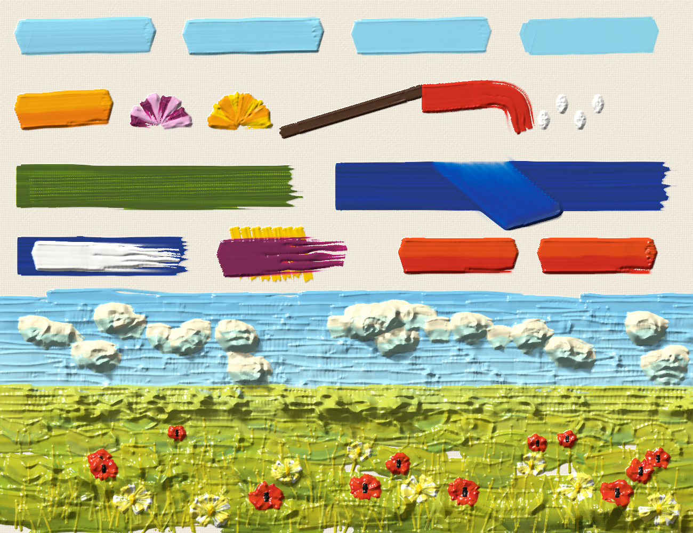

*Top: a palette knife at pressure 0.15, 0.4, 0.7 and 0.95, from a thick slab
to paint scraped into the weave. Second row: the large trowel, small-trowel
and pear-knife petals (each pulled in towards the centre), a line with a straight blade pulled along its
length, the angled blade turning a corner, spoon dabs. Third row: a comb
scoring grooves into wet green, and the scraper taking wet blue back to the
canvas. Fourth row: white laid on wet blue with a light touch, magenta
skimmed over dry ridges of yellow, and a double-loaded slab lifted off
cleanly (`lift=0`) and pulled up (`lift=1`). Below: a small field of flowers,
all knife work: sky in long pulls with clouds twisted on thick, a field of
overlapping pulls, grass dabbed with the edge of a blade, poppy and daisy
petals pulled in towards their centres.*

## How it works

**Color is spectral.** Each paint is turned into a smooth reflectance spectrum
(24 bands, 400–700 nm) using Scott Burns' method, then into Kubelka-Munk
absorption `K(λ)` and scattering `S` per unit volume. `S` is set from the
paint's lightness and `opacity`, and `K` is solved so that a normal-thickness
layer over white reproduces exactly the color you asked for. Mixing adds `K`
and `S` by volume; that's why mixes behave like pigments (darker, subtractive,
complementaries going to near-black, white making tints rather than washing
out).

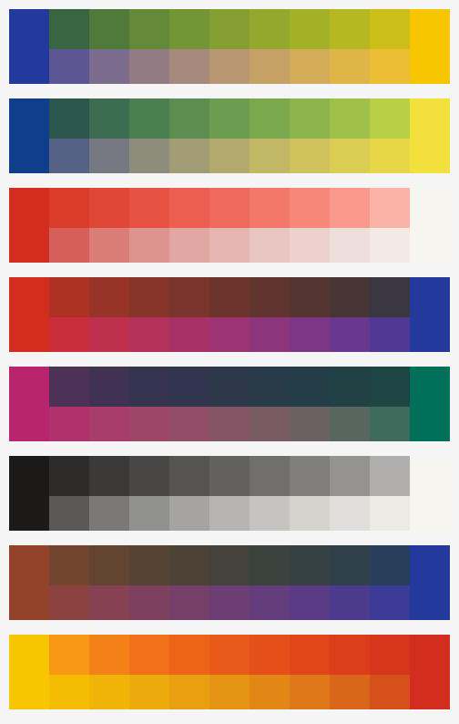

*In each pair of rows, the top row is paint mixing and the bottom row is naive
RGB averaging.*

**Layers have thickness.** The canvas stores, per pixel, a dry ground spectrum
and two wet sublayers: `under` (older wet paint) and `top` (the latest
stroke). Rendering uses the finite-thickness Kubelka-Munk formula, so thin
paint lets the underlayer show through, transparent paints glaze, and opaque
paints cover. Each pixel also records how much of it the brush actually
covered, computed from the exact footprint, so stroke edges and lines thinner
than a pixel are anti-aliased: an edge pixel is half covered by a normal
layer of paint rather than fully covered by an impossibly thin one. Paint too
thin to form a film (dry-brush specks, smears) also renders as partial
coverage. A new stroke only buries the wet paint under it where it lays a
covering film: along the feathered edge of a soft brush, a faint trace of
paint stirs into the wet layer instead. So white scrubbed over white on a wet
blue sky stays white where the strokes overlap; it doesn't leave a blue ring
at every soft edge.

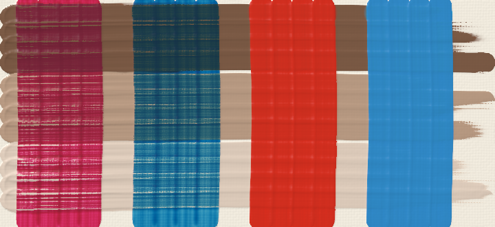

*Left two columns: transparent glazes over a dried value study. Right two columns:
opaque paints that hide it.*

**The brush moves paint around.** The brush is a footprint (round,
rectangular, oval-tipped or a fan of clumps; no individual bristles). Its
hair is a pattern of clumps over the stroke, fixed in stroke coordinates
(distance along it, position across the bundle), which every step of the
stroke reads the same at a pixel: where the clumps run it lays less and
combs thick paint into furrows, between them it lays more; its edges and
the points where a running-dry brush still catches follow the same lanes. Its
paint sits in 24 columns across it (around the bundle on a round, mapped to
the footprint through the current roll), each with a tip, a belly
(reservoir) and a heel that only gives paint up when squeezed. At each step
along the spline it does four things:

1. It pushes some of the wet paint ahead of it (drag).
2. It lifts some of the wet paint (pickup). A thin film only wets the tip;
   deeper wet paint comes further up between the hairs, more so when pressing
   bends them, so part of it goes into the reservoir and stays in the brush
   for longer. It glides on the paint it has just laid itself: it doesn't lift
   that (it lays a little less instead, what its own bristles would have
   carried on), and while it is loaded it doesn't push it either; a brush
   running dry smears its own last paint on ahead.
3. It lays down a mix of what the tip holds (deposit), refilling the tip from
   the reservoir. Neighbouring columns and layers slowly share their paint as
   the brush flexes (the `blending` setting).
4. It stirs the new paint into the wet paint below, more with more pressure
   and `mixing` (ploughing, less: the old paint folds up over the new between
   its grooves instead, once the stroke has passed, as far as `mixing` lets
   it).

Together this gives smears that fade over a short distance, dirty brushes,
streaky wet-into-wet blends, and strokes that run dry and break up on the
canvas tooth.

**Paint has height and gets pushed around.** The underside of the tool sits
at a level above the canvas. For bristles, that's about the thickness they
lay, lower along the hair lines; pressed hard through thick, stiff wet paint,
a brush's bristles go down through their own load towards a level set by
pressure and stiffness instead, deeper along the lines of their clumps (see
ploughing, under Impasto). For a knife, it's the blade resting on the
highest points below it (thread tops, dry ridges, and wet paint from
earlier strokes, which it sinks into under pressure), plus a gap set by
pressure, and no higher than the paint film under it. The blade is rigid
along the direction it moves, so its height varies only along its length.
Wet paint standing above that level is shifted:

* partly out past the edges, into ridges with anti-aliased edges;
* the rest ahead of the tool, where it piles up when the tool lifts;
* for brushes, partly onto the brush (pickup).

A tool carrying more paint than it holds squeezes the extra out at its edges,
more under pressure. A knife then fills the space under its blade up to that
level. Thick brush paint likewise fills the hollows of the weave under it
rather than coating them evenly. After each stroke the paint settles:
wherever it is steeper than its body can hold, it flows downhill.

**Under a knife, wet paint flows.** The blade drags the wet paint it touches,
as a thin film between the moving blade and the still canvas. Paint near the
blade travels almost with it, paint at the canvas hardly moves, and paint
above the blade is bulldozed ahead. Near the edges of the mark, some of the
paint that was lying there spills out sideways into lips: a narrow mark
spills most of what it cuts through, a wide scraper only at its ends, and a
heap the blade is pushing along rides with it instead of leaving trails.
A knife doesn't pick wet paint up as it goes (the flow carries it), so it
doesn't get dirty the way a brush does: the scraped paint is left where the
knife lifts.

* **Layers keep their order.** Each wet layer moves at its own speed, so
  white dragged over purple stays on top of it.
* **Viscosity.** Neighbouring paint drags each other along, so the speeds vary
  smoothly.
* **Small steps.** The paint is moved by fluxes between neighbouring pixels in
  steps of under a pixel, so nothing is lost and the pile in front of the
  blade travels smoothly.
* **Resting level.** The blade rests on the high points under it, bends to
  follow the surface over a span set by its stiffness, and sinks into the
  paint by a share of its thickness that grows with pressure.
* **Its own load.** The blade glides on the fresh paint it lays.

Paint volume is conserved throughout. Each step integrates the
brush's exact sweep over each pixel, so the result doesn't depend on the step
size: a stroke cut into finer steps (a gentle curve) lays about the same
paint as a straight one, also from an overloaded brush, whose glob feeds what
it lays directly. (A tight wiggle of a wide brush still lays somewhat more:
the inside of each turn is passed over twice.) The footprint is swept at its current angle and size (both can change
along the stroke), which is what makes a flat's square ends, its thin edge
and its twisted ribbons.

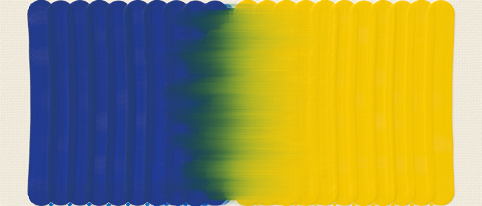
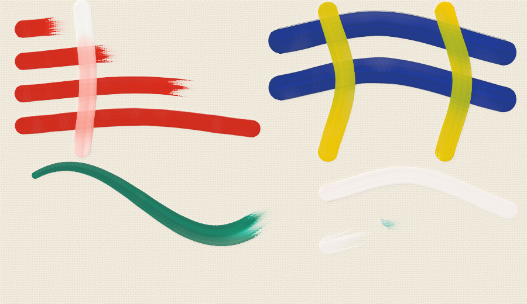

**Light.** Rendering lights the same surface the paint is pushed around on:
the canvas weave, dried paint and wet paint. Thin strokes get soft
shoulders; impasto keeps every ridge and groove.
It then shades it with a lamp of some size: ridges cast shadows onto the
paint behind them, sharp at their foot and softer further away; grooves,
hollows and the foot of thick paint get less light from the room; and the oil
mirrors the lamp in sharp highlights on the slopes that face it, brighter and
sharper while the paint is wet. On a narrow crest, furrow or lip the
highlight is gathered a little way along it, so a glint on a slanting crest
is a line, not a string of beads at the steps of the pixels. Highlights roll
off towards white rather than clip.

## Limitations

* No bristle-level simulation or drying over time (`dry()` is
  all-or-nothing). Absorbency acts immediately rather than as the paint
  dries, and wet paint settles right after each stroke rather than over
  minutes.
* Each pixel keeps two wet layers (the latest one and everything wet beneath
  it). A third wet layer is merged into one of them: new paint goes on top
  where it covers (a faint trace stirs into the top layer instead), while
  paint that is only pushed around merges with the layer it is most like.
  Very complex wet layering (three different colours stacked, then scraped)
  loses some of its structure.
* Wet paint under a knife flows as a thin film along the knife's direction of
  travel only, and brushes still move paint by simpler rules (pickup, smear,
  bow wave). Paint folding over itself or swirling sideways (marbling) isn't
  simulated.
* Knives lie flat on the canvas (or, with a tiny `aspect`, on their edge);
  the tilt of the blade (spreading with the trailing edge down vs scraping
  with the leading edge) is folded into pressure.
* Paint optics are derived from RGB colors, not measured pigment data. If you
  have measured spectra, `Paint.from_optics(K, S)` accepts them directly.
* Speed: a few milliseconds for a small brush stroke, about a tenth of a
  second for a big heavily loaded one or a knife stroke; a lit render of an
  800×600 canvas takes about a quarter of a second. Memory is about 0.35 KB
  per pixel (a 1000×750 canvas needs ~265 MB, and ~100 MB more while it
  renders); about 0.65 KB per pixel painted in reverse.

## Development

Python 3.11 to 3.15. The checks run with [uv](https://docs.astral.sh/uv/) and tox:

```bash
uv sync --group dev   # the tools, and the package installed from the checkout
uv run tox            # every Python version (formatting, lint, types and tests),
                      # the spelling, and the built wheel installed on its own
uv run tox -e check   # formatting, lint, types and tests, once, on the current Python
uv run pytest         # just the tests
make coverage         # test coverage, with an HTML report in htmlcov/
make spell            # spelling (cspell; needs Node.js, installs the npm packages if needed)
make pre-push         # tox, the coverage, and the spelling of the files you changed
```

Formatting is black and ruff format (88 columns), lint is ruff (with a cap
on how complex a function may grow, outside the compiled kernels), types are
pyright. The tests are in `tests/`, one file per topic (`test_strokes.py`,
`test_knives.py`, `test_render.py`, `test_inputs.py` and so on). Run on an
empty numba cache, they first wait for the compiler, as the first stroke
after installing does.

CI runs the spell check, then the tox checks on each Python version, the
tests and the built wheel on Windows, and the coverage (sent to Codecov), on
every pull request and every push to `main`. The coverage leaves out the
compiled engine (`oilpaint/_engine.py`): coverage.py can't see inside
numba-compiled code, though every test runs it.

`tools/bench.py` times the stroke engine on sixteen fixed scenes of marks
and prints a hash of what each paints, so a change meant to make it faster
can show that it paints the same:

```bash
uv run python tools/bench.py                 # the timing table
uv run python tools/bench.py -k knife -n 9   # the scenes whose name has "knife", best of 9
uv run python tools/bench.py --save DIR      # also keep each scene's canvas state
uv run python tools/bench.py --compare DIR   # ... and compare with a kept one, byte for byte
```
