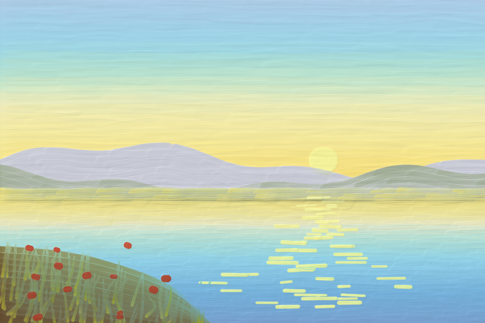

# oilpaint

A small Python API that mimics oil painting. You describe **strokes** (a spline,
a paint, an amount of paint, a brush width and pressure) and the library
simulates how the paint is laid down, picked up, dragged and mixed on the
canvas. Colors mix like real pigments (blue + yellow gives green, not grey),
using spectral Kubelka-Munk theory.

Only dependency: `numpy`. (Pillow is optional, for `Canvas.to_pil()`.)



## Quick start

```python
from oilpaint import Canvas, Paint

canvas = Canvas(600, 400)

blue = Paint("#23399b", opacity=0.5)
yellow = Paint("#f7c600")

# A stroke: a smooth spline through these points, a paint, an amount of paint.
canvas.stroke([(60, 140), (250, 100), (540, 170)], paint=blue, amount=12, width=50)

# Cross it while it's wet. Pressure decides how much the colors churn together.
canvas.stroke([(200, 30), (230, 200), (190, 370)], paint=yellow, amount=10, width=40, pressure=0.2)
canvas.stroke([(400, 30), (430, 200), (390, 370)], paint=yellow, amount=10, width=40, pressure=0.9)

# No paint = a clean brush that drags and blends what's wet.
canvas.stroke([(80, 300), (560, 300)], width=40, pressure=0.6)

canvas.save("painting.png")
```

Run `python examples/demo.py` to regenerate all the images in `examples/output/`,
and `pytest tests` to run the tests.

## API

### `Paint(color, opacity=1.0, strength=1.0, name=None)`

* `color`: how the paint looks brushed out at normal thickness on white
  canvas. Use `"#rrggbb"`, a float triple in 0..1, or an int triple in 0..255.
* `opacity`: 0..1, how much it hides what's underneath. 1 is a body color,
  ~0.3 a glazing color, 0 a pure dye.
* `strength`: tinting strength, i.e. how much it dominates mixtures.

Useful members:

* `Paint.mix((a, 1), (b, 3))` mixes paints by volume on the palette.
* `paint.appearance(thickness, over=color)` gives the color of a layer over a ground.
* `paint.masstone` is the color straight from the tube.
* `mix_colors(["#1b3fa0", "#f5d000"])` gives the hex color of a quick palette mix.
* `oilpaint.palette` has ready-made paints: `TITANIUM_WHITE`, `CADMIUM_YELLOW`,
  `ULTRAMARINE_BLUE`, `ALIZARIN_CRIMSON`, `PHTHALO_BLUE`, `BURNT_UMBER`, …
  It also has `MEDIUM`, a clear medium for thinning paint into a glaze:
  `Paint.mix((ALIZARIN_CRIMSON, 1), (MEDIUM, 3))`.

### `canvas.stroke(path, paint, amount=6, width=None, pressure=0.5, brush=None, **options)`

| parameter  | meaning |
|------------|---------|
| `path`     | List of `(x, y)` points: a smooth Catmull-Rom spline passes through them. Or a `CatmullRom`, `Bezier` (anchor, handle, handle, anchor, …) or `Polyline`. One point makes a dab. |
| `paint`    | A `Paint` or a color. `None` uses a clean brush (blending), or the given `brush`. |
| `amount`   | Paint on the brush, in "brush widths of solid stroke": `amount=6` covers about 6 widths before the brush runs dry and starts to break up. A bigger load also gives thicker paint (impasto). Small brushes need bigger amounts to go as far. |
| `brush`    | The tool: a `BrushType` (e.g. `brushes.FLAT_HOG`, see below), or a `Brush` that keeps leftover paint and dirt between strokes. Default: a medium round. |
| `width`    | Brush width in px; defaults to the brush's own size. A number, one value per control point, or `f(u)` with `u` in 0..1 along the stroke. |
| `pressure` | 0..1, same forms as `width`. Light pressure lays paint *on top of* wet paint. Heavy pressure releases more paint and churns it *into* the wet paint below. Soft, pointed brushes also get wider under pressure. |
| `angle`    | Brush angle in degrees, same forms as `width`: 0 drags a flat broadside, 90 on its edge. Vary it to twist the brush mid-stroke. |
| `follow_path` | `True`: the angle turns with the stroke. `False`: the angle is fixed on the canvas, like a calligraphy nib. |
| `mixing`   | How readily the stroke stirs into the wet paint below. |
| `pickup`   | How much wet paint the brush lifts and carries along. |
| `drag`     | How much wet paint the brush pushes ahead. |
| `smear`    | How long picked-up color lingers on the brush tip, roughly in widths. |
| `streaks`  | Brush-hair streak texture, 0..1. |
| `taper`    | Feathered ends: fraction of the length where the brush is lowered/lifted. |
| `seed`     | Seed for the stroke's texture. |

`mixing`, `pickup`, `drag`, `smear`, `streaks`, `taper`, `angle` and
`follow_path` default to the brush type's own character; pass them to
override it for one stroke.

`stroke()` returns the `Brush` it used. You can also build a `Stroke(...)`
dataclass with the same fields and call `canvas.paint(stroke1, stroke2, ...)`.

### Brushes

`oilpaint.brushes` is a rack of ready-made tools:

| preset | what it is |
|--------|------------|
| `ROUND`, `ROUND_HOG`, `ROUND_SABLE` | Rounds. Pointed rounds paint thin lines with a light touch and swell under pressure. |
| `LINER`, `RIGGER` | Ultra-fine rounds for outlines and long, fine lines (branches, rigging). `amount` is measured in brush widths, so load these generously, e.g. `amount=200` for a 500 px line. |
| `MOP` | Very large, very soft and absorbent: soft blending, feathered edges. |
| `DEER_FOOT` | A round cut on a slant, for stippling foliage and texture. |
| `FLAT_HOG`, `FLAT_SABLE` | Long flats: square ends, broad strokes, thin lines when turned on edge. |
| `BRIGHT` | A short, stiff flat: controlled strokes, pushes stiff paint. |
| `ANGLED`, `DAGGER` | Flats with bristles cut on a bias: the toe touches first; daggers taper sharply. |
| `BLENDER` | A wide soft flat for glazes and smooth gradients. |
| `FILBERT_HOG`, `FILBERT_SABLE` | Flats with an oval tip: broad strokes, or petals and leaves (press, then lift). |
| `FAN_HOG`, `FAN_SOFT` | Separate bristle clumps: grass, hair, foliage, or feathering. |
| `PALETTE_KNIFE` | A steel blade: smooth slabs of thick paint, sharp edges, no brush marks. |
| `RAG` | Lifts wet paint without laying any down: wipe out lights or correct mistakes. |

```python
from oilpaint import BrushType, brushes

canvas.stroke(path, "#1d3f9a", brush=brushes.FLAT_HOG)                 # 24 px hog flat
canvas.stroke(path, "#1d3f9a", brush=brushes.FLAT_HOG.sized(48))       # a bigger one
canvas.stroke(path, "#1d3f9a", brush=brushes.FLAT_HOG, angle=lambda u: 90 * u)   # twist into a ribbon

# make your own: shape + size + hair, then tweak any property
soft_flat = brushes.make("flat", 30, hair="sable", length=0.8)
grass_fan = brushes.make("fan", 40, hair="hog", clumps=12)
nib = brushes.FLAT_SABLE.with_(angle=40, follow_path=False)            # calligraphy
custom = BrushType(shape="filbert", width=26, aspect=0.45, stiffness=0.6, capacity=1.4)
```

`BrushType` fields:

| field | meaning |
|-------|---------|
| `shape` | `round`, `flat` (square ends), `filbert` (flat with an oval tip), `fan` (spread of separate clumps). |
| `width` | Default width in px. |
| `aspect` | Footprint thickness relative to width: 1 for a round, ~0.2 for a flat, 0.04 for a knife blade. |
| `angle`, `follow_path` | Default orientation (see `stroke`). |
| `stiffness` | 0 = very soft (sable, squirrel) … 1 = very stiff (hog, knife). Stiff tools leave stronger ridges and ragged edges, push more paint and blend less. |
| `bristles` | Density: 0 = sparse and coarse (bold streaks, dry-brush breakup) … 1 = dense and fine (smooth). |
| `capacity` | How much paint sits in the tip: above 1 ("fat") the brush keeps colour it picked up and smears it further; below 1 it is quickly cleaned by its own fresh paint. (How far a stroke reaches is set by `amount`.) |
| `spread` | How much the brush widens under pressure. |
| `clumps` | Number of separate bristle clumps (fans). |
| `slant` | Bristles cut on a bias (angled ~0.5, dagger ~0.9): the toe touches first. |
| `softness` | Feathered edges and ends (mops, blenders). |
| `taper` | Default feathered ends for strokes made with it. |
| `deposits` | `False` for tools that only lift paint (the rag). |
| `streaks`, `pickup`, `drag`, `mixing`, `rough` | Explicit overrides of the behavior otherwise derived from stiffness and bristles. |

`brushes.make(shape, width, hair, length)` picks sensible values from the
hair (`hog`, `mongoose`, `synthetic`, `sable`, `squirrel`) and the bristle
length (0 = short like a bright: stiffer, smaller tip capacity; 1 = long:
springier, larger tip capacity). `brushes.catalog()` lists the presets.


*Each preset, top to bottom (`ROUND` … `BLENDER`, in the order of the table):
a straight stroke, an S with light → heavy → light pressure, a dab, a stroke
on the brush's edge, and a stroke that twists from broadside to edge-on.*


*Calligraphy with a flat at a fixed angle, filbert leaves, hog-fan grass,
deer-foot stippling, a mop blending two wet colors, palette-knife slabs, rigger
branches, an angled flat cutting a corner, dagger strokes.*

### `Canvas(width, height, ground=None, texture=None, weave=None, seed=None, surface=None)`

* `surface` is what you paint on (see **Surfaces** below). Default: a
  generic primed canvas.
* `ground` overrides the surface's priming color, or is an `(H, W, 3)` sRGB
  image to paint over. `texture` and `weave` are shortcuts for the surface's
  `relief` and `scale`.
* `canvas.dry()` lets everything dry. Later strokes stop mixing with it and
  glazes layer over it optically.
* `canvas.render(lighting=True, light=(-0.6, -0.8, 1.1), relief=1.0, gloss=1.0)`
  returns an `(H, W, 3)` sRGB float image, lit to show impasto and the surface texture.
* `canvas.save("out.png", **render_options)` and `canvas.to_pil()` export the image.
* `canvas.color_at(x, y)`, `canvas.thickness`, `canvas.wet_thickness` and
  `canvas.reflectance()` let you inspect the paint.

### Surfaces

`oilpaint.surfaces` has ready-made supports:

| preset | what it is |
|--------|------------|
| `CANVAS` | The original generic primed canvas (the default). |
| `LINEN_FINE` | Fine, oil-primed linen: irregular threads with slubs, moderate tooth, barely absorbent. |
| `LINEN_COARSE` | Coarse linen: big uneven threads; a lightly dragged stroke breaks up on them (scumbling). |
| `COTTON_DUCK` | Cotton with acrylic gesso: an even, mechanical weave; bright and slightly absorbent. |
| `CANVAS_BOARD` | Fine cotton on card: light, even texture; fairly absorbent. |
| `OIL_PAPER` | Felted paper fibres with a pronounced tooth; absorbent. |
| `GESSO_PANEL` | Oak panel with a chalk gesso, as used by the Flemish masters: smooth, very absorbent, with priming brushmarks and a hint of wood grain. |
| `COPPER` | Glass-smooth and very slick; nothing is absorbed; the warm metal glows through thin paint. |

```python
from oilpaint import Canvas, Surface, surfaces

canvas = Canvas(1200, 800, surface=surfaces.GESSO_PANEL)
canvas = Canvas(1200, 800, surface=surfaces.LINEN_FINE.with_(toning="#c49a6c"))      # toned ground
canvas = Canvas(1200, 800, surface=Surface(texture="twill", scale=5, tooth=0.6, absorbency=0.3))
```

`Surface` fields:

| field | meaning |
|-------|---------|
| `texture` | `linen`, `cotton`, `twill`, `paper`, `wood`, `smooth`, or `canvas` (the original weave). |
| `scale` | Texture size in px: thread spacing, paper tooth, or wood-ring spacing. |
| `irregularity` | Woven textures: 0 = perfectly even threads … 1 = very irregular. |
| `angle` | Wood-grain direction in degrees. |
| `relief` | How deep the texture is, under the light and through thin paint. |
| `tooth` | 0..1, how much the surface grips the brush. A rough tooth breaks up lightly pressed or dry strokes and pulls paint off the brush; a smooth one lets strokes glide unbroken. |
| `absorbency` | 0..1, how much the priming drinks oil. Paint drags, blends less and runs out sooner on an absorbent ground, and thin paint "sinks in": it goes matte, and darks look lighter and duller. |
| `slickness` | 0..1, how freely wet paint slides and lifts off the bare surface. Paint wipes cleanly off a slick surface and leaves a stain in an absorbent one. 0.5 is neutral. |
| `ground` | Priming color. |
| `toning`, `toning_strength` | A transparent toned layer (imprimatura) brushed over the priming. |
| `priming_marks`, `priming_angle` | Visible brushmarks in the priming, and their direction. |

`surfaces.catalog()` lists the presets. Scales assume about 1 px ≈ 0.3 mm;
use `.with_(scale=...)` to match other canvas sizes.


*The same marks on each surface, left to right and top to bottom: canvas, fine
linen, coarse linen, cotton duck, canvas board, oil paper, gesso panel, copper,
and fine linen with a toned ground. The marks are: a loaded hog flat, the same
brush dragged lightly (it breaks up on coarse linen and paper), a dark (it sinks
in on absorbent grounds), an ochre patch wiped back with the `RAG` tool (clean
on copper and oil-primed linen, a stain on gesso and paper), and a palette-knife
slab.*

### `Brush`

A `Brush` is one physical brush with paint on it: a `BrushType` plus its
current load and dirt.

```python
from oilpaint import Brush, brushes, palette

brush = Brush(brushes.FILBERT_HOG).load(palette.TITANIUM_WHITE, amount=8)
canvas.stroke(path1, brush=brush)   # drags through wet red: brush turns pinkish
canvas.stroke(path2, brush=brush)   # still pinkish, with what's left
brush.clean()
```

## How it works

**Color is spectral.** Each paint is turned into a smooth reflectance spectrum
(24 bands, 400–700 nm) using Scott Burns' method, then into Kubelka-Munk
absorption `K(λ)` and scattering `S` per unit volume. `S` is set from the
paint's lightness and `opacity`, and `K` is solved so that a normal-thickness
layer over white reproduces exactly the color you asked for. Mixing adds `K`
and `S` by volume; that's why mixes behave like pigments (darker, subtractive,
complementaries going to near-black, white making tints rather than washing
out).


*In each pair of rows, the top row is paint mixing and the bottom row is naive
RGB averaging.*

**Layers have thickness.** The canvas stores, per pixel, a dry ground spectrum
and two wet sublayers: `under` (older wet paint) and `top` (the latest
stroke). Rendering uses the finite-thickness Kubelka-Munk formula, so thin
paint lets the underlayer show through, transparent paints glaze, and opaque
paints cover. Each pixel also records how much of it the brush actually
covered, computed from the exact footprint, so stroke edges and lines thinner
than a pixel are anti-aliased: an edge pixel is half covered by a normal
layer of paint rather than fully covered by an impossibly thin one. Paint too
thin to form a film (dry-brush specks, smears) also renders as partial
coverage.


*Left two columns: transparent glazes over a dried value study. Right two columns:
opaque paints that hide it.*

**The brush moves paint around.** The brush is a footprint (round,
rectangular, oval-tipped or a fan of clumps; no individual bristles) with a
reservoir and a small tip. At each step along the spline it does four things:

1. It pushes some of the wet paint ahead of it (drag).
2. It lifts some of the wet paint into its tip (pickup).
3. It lays down a mix of what the tip holds (deposit), refilling the tip from
   the reservoir.
4. It stirs the new paint into the wet paint below, more with more pressure.

Together this gives smears that fade over a short distance, dirty brushes,
streaky wet-into-wet blends, and strokes that run dry and break up on the
canvas tooth. Paint volume is conserved throughout. Each step integrates the
brush's exact sweep over each pixel, so the result doesn't depend on the step
size. The footprint is swept at its current angle and size (both can change
along the stroke), which is what makes a flat's square ends, its thin edge
and its twisted ribbons.


## Limitations

* No bristle-level simulation, paint flow or drying over time (`dry()` is
  all-or-nothing). Absorbency acts immediately rather than as the paint dries.
* Paint optics are derived from RGB colors, not measured pigment data. If you
  have measured spectra, `Paint.from_optics(K, S)` accepts them directly.
* Pure numpy: about 20–30 ms per stroke on a typical canvas. Memory is about
  0.3 KB per pixel (a 1000×750 canvas needs ~240 MB).
